# ARCH_DIAGRAMS — Подробные диаграммы FROST

> Дополняет [ARCH.md](ARCH.md). Все диаграммы — Mermaid (рендерятся в GitHub / VSCode / Markdown-просмотрщиках с поддержкой Mermaid).
>
> Каждая секция отвечает за один аспект системы: один сценарий — одна диаграмма.

---

## 1. System Context (C4-L1)

Кто и как взаимодействует со FROST.

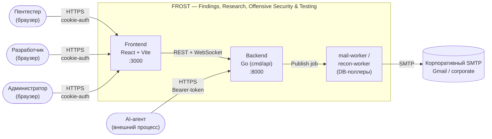

---

## 2. Container Diagram (C4-L2) — Docker Compose сервисы

Что развёрнуто в docker-compose и как сервисы общаются.

```mermaid
flowchart TB
    subgraph Browser["Браузер"]
        ClientApp["SPA<br/>(React 18, frost UI)"]
    end

    subgraph Compose["docker-compose"]
        direction TB

        subgraph App["Application tier"]
            Frontend["frontend<br/>Vite + nginx TLS<br/>:3000"]
            Backend["backend<br/>Go cmd/api<br/>:8000"]
            MailWorker["mail-worker /<br/>recon-worker<br/>(Go, DB-поллеры)"]
            ReportSidecar["report-sidecar<br/>(Python .docx)"]
        end

        subgraph Infra["Infrastructure tier"]
            Postgres[("db<br/>PostgreSQL 16<br/>:5433→5432")]
            MinIO[("minio<br/>S3-compatible<br/>:9000 + :9001")]
            Rabbit[("rabbitmq<br/>3-management<br/>:5672 + :15672")]
            Mailpit[("mailpit<br/>dev SMTP catcher<br/>:1025 + :8025")]
        end
    end

    ExternalSMTP[("Прод SMTP<br/>(Gmail / corporate)")]

    ClientApp -.->|HTTPS| Frontend
    Frontend -->|proxy /api| Backend
    Frontend -->|proxy /ws| Backend

    Backend -->|pgx/pgxpool| Postgres
    Backend -->|minio-go v7| MinIO
    Backend -.->|amqp091 (опц. fanout)| Rabbit
    Backend -->|HTTP (генерация .docx)| ReportSidecar

    MailWorker -->|poll mail_jobs / farm| Postgres
    MailWorker -->|SMTP/XOAUTH2<br/>dev| Mailpit
    MailWorker -.->|SMTP<br/>prod| ExternalSMTP
```

---

## 3. Backend — гексагональная архитектура

Запрос проходит путь chi-хендлер (адаптер) → use-case (контекст) → порт `Store` → repo (адаптер) → sqlc/pgx. DI — явная сборка в `cmd/api` (composition root), а не DI-контейнер.

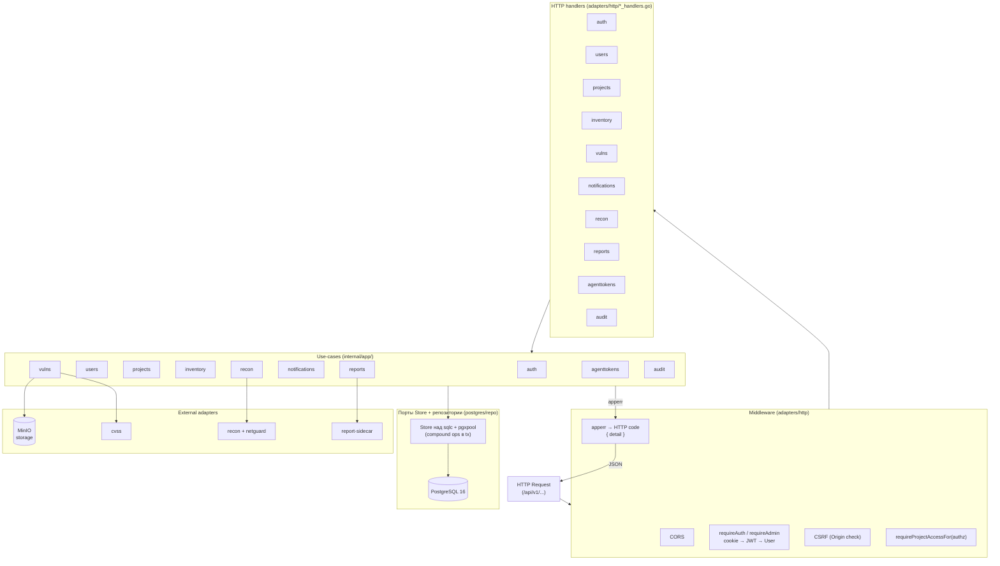

---

## 4. Аутентификация — login, refresh, logout

JWT в HttpOnly Secure cookies, CSRF через SameSite=Strict + проверку Origin. Refresh-токены с ротацией.

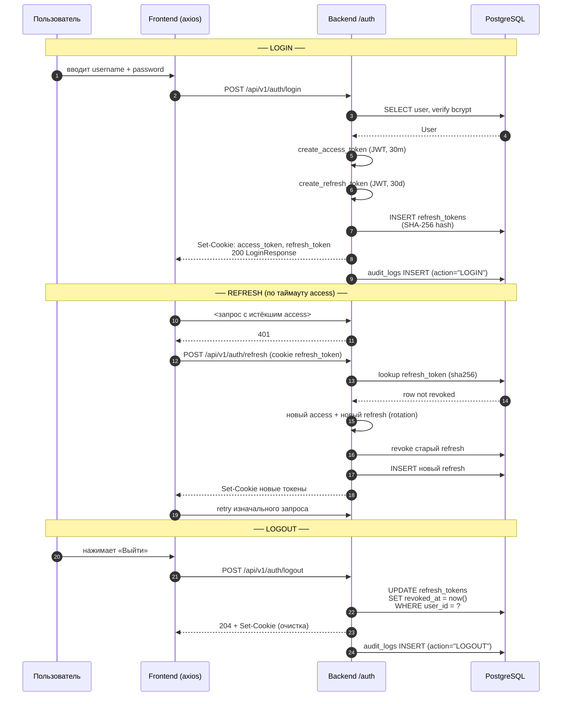

---

## 5. Управление сессией — refresh rotation детальнее

Защита от replay и кражи refresh-токена.

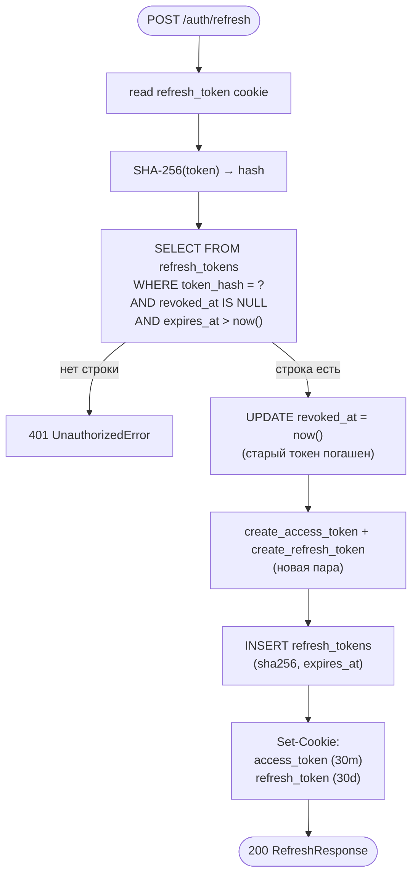

---

## 6. CSRF + Origin защита

`SameSite=Strict` блокирует cross-site cookies; дополнительно проверяем заголовок `Origin`.

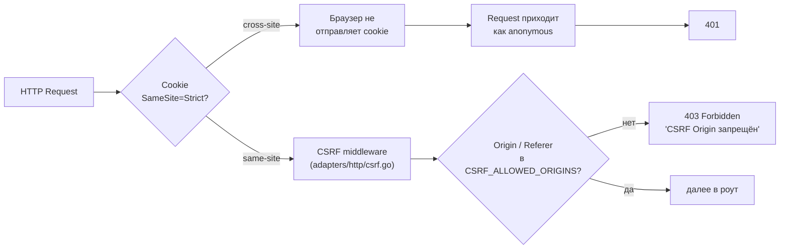

---

## 7. Доступ к проекту — IDOR-проверки

`require_project_access` гарантирует, что pentester видит только свои проекты, admin — все.

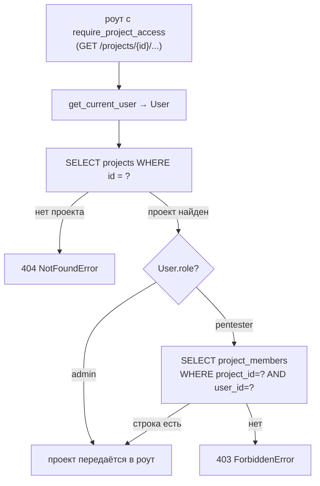

---

## 8. Жизненный цикл уязвимости

Статусы и workflow_steps (этапы воспроизведения).

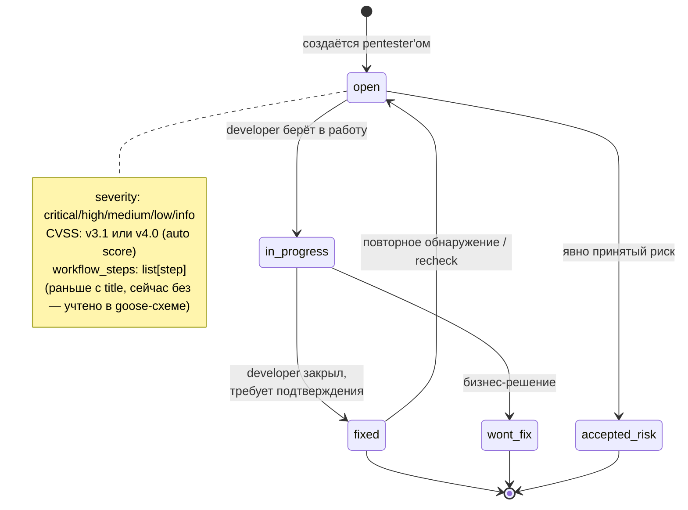

---

## 9. Загрузка evidence-файла в MinIO

Конвейер с валидацией и transaction outbox (метаданные в Postgres → объект в MinIO).

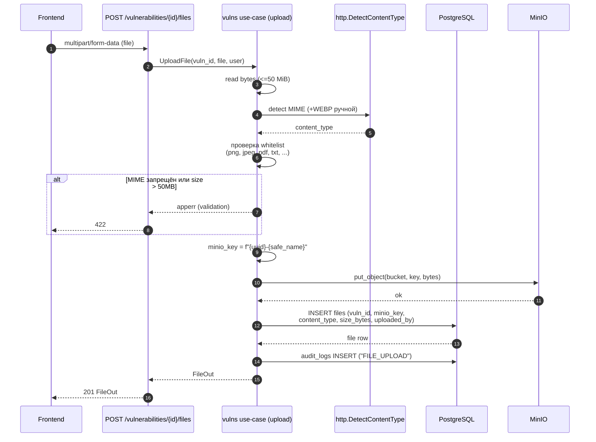

---

## 10. Mail outbox + worker

Outbox-паттерн поверх durable-очереди в БД: роут вставляет `MailJob(status=pending)`, Go-воркер `cmd/mail-worker` поллит таблицу `mail_jobs` (≤5 с), забирает задачу, рендерит письмо и шлёт по SMTP. RabbitMQ не участвует в базовом пути (только опциональный fanout на несколько инстансов).

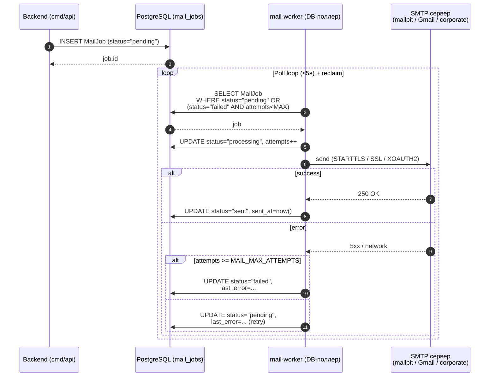

---

## 11. SSRF & DNS-rebind защита — внутренности

Исходящие HTTP-запросы делает только рекон-ферма. Предикат блок-листа
(`internal/adapters/recon/netguard`) — единый список внутренних адресов; кастомный
`DialContext` в recon-probe применяет его повторно прямо перед connect, закрывая окно
DNS-rebinding между резолвом и подключением. Редиректы отключены.

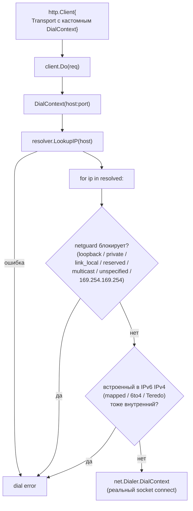

---

## 12. WebSocket — каналы и события

Backend держит три типа каналов через WebSocket-хаб (`internal/adapters/ws`).

```mermaid
flowchart TB
    Browser1["Pentester @ ProjectDetailPage"]
    Browser2["Developer @ ProjectDetailPage"]
    Browser3["Pentester @ ProjectsPage"]
    Browser4["Pentester в notification toast"]

    subgraph WS["WebSocket-хаб (adapters/ws)"]
        ProjectsIdx["/ws/projects-index<br/>{ws_set}"]
        ProjectRoom["/ws/projects/{id}<br/>{project_id → ws_set}"]
        UserChan["/ws/notifications<br/>{user_id → ws_set}"]
    end

    subgraph Services["События use-cases"]
        CreateVuln["vulns.Create"]
        EditHost["inventory.UpdateHost"]
        AddComment["projects/comment Create<br/>(@mention)"]
        CreateProj["projects.Create"]
        AddNote["projects/note Create"]
    end

    Browser1 -->|connect| ProjectRoom
    Browser2 -->|connect| ProjectRoom
    Browser3 -->|connect| ProjectsIdx
    Browser4 -->|connect| UserChan

    CreateVuln -->|broadcast project_id| ProjectRoom
    EditHost -->|broadcast project_id| ProjectRoom
    AddComment -->|broadcast project_id| ProjectRoom
    AddComment -->|notify_user mentions| UserChan
    AddNote -->|broadcast project_id| ProjectRoom
    CreateProj -->|broadcast_projects_index| ProjectsIdx

    ProjectsIdx -->|"event":"created"<br/>"entity":"project"| Browser3
    ProjectRoom -->|"event":"created"<br/>"entity":"vulnerability"| Browser1
    ProjectRoom -->|"event":"updated"<br/>"entity":"host"| Browser2
    UserChan -->|"event":"notification"<br/>"entity":"notification"| Browser4
```

Подписка происходит вместе с handshake, аутентификация — `access_token` из cookie.

---

## 13. AI Agent API `/api/v2` — scoping и проверка доступа

Отдельный роутер (`apiv2`, strict JSON), смонтированный на `/api/v2`. Аутентификация — Bearer-токен, выпущенный администратором.

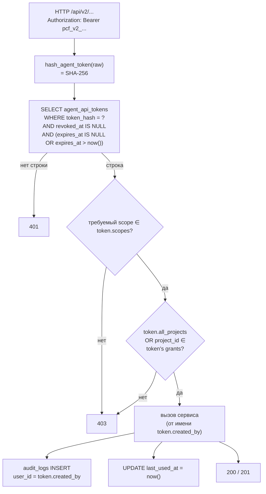

### Карта scopes → endpoints

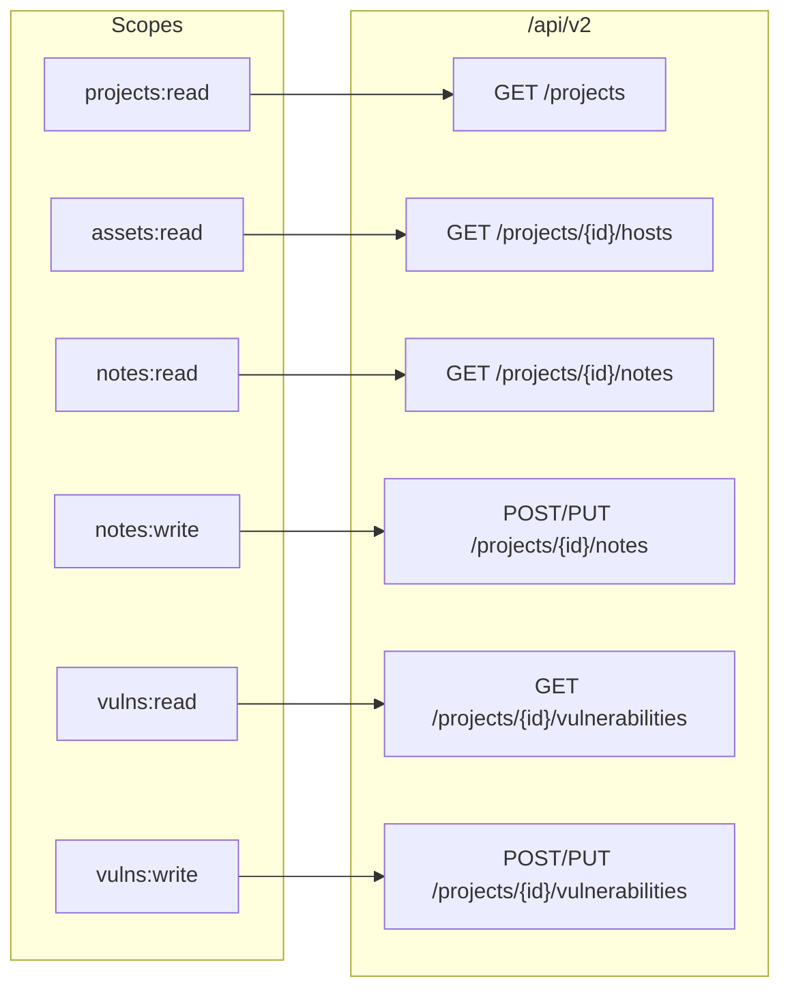

---

## 14. Audit log — запись и чтение

Единое хранилище — PostgreSQL. Запись синхронная с основной транзакцией, чтение через фильтры с full-text по action / entity_type / ip / username / cast(details::text).

```mermaid
flowchart TB
    subgraph Write
        ServiceOp["любая use-case операция<br/>(CRUD, LOGIN, FILE_UPLOAD, ...)"]
        ServiceOp --> Commit["commit основной транзакции"]
        Commit --> AuditLog["audit.Log(<br/>action, user_id, entity_type,<br/>entity_id, details, ip_address)"]
        AuditLog --> AuditAdd["INSERT audit_logs (sqlc)"]
        AuditAdd --> AuditCommit["commit"]
    end

    subgraph Read["GET /api/v1/audit-logs (admin)"]
        Query["параметры:<br/>user_id, username, action,<br/>entity_type, entity_id, ip_address,<br/>query, created_from, created_to,<br/>page, size"]
        Query --> Join["SELECT audit_logs LEFT JOIN users<br/>(username по user_id)"]
        Join --> Filters["WHERE conditions:<br/>• не показывать LOGIN with source=refresh<br/>• ILIKE для текстовых полей<br/>• datetime range для created_at"]
        Filters --> FullText{"query?"}
        FullText -->|есть| FTSearch["OR(<br/>action ILIKE,<br/>entity_type ILIKE,<br/>ip ILIKE,<br/>User.username ILIKE,<br/>cast(details::text) ILIKE)"]
        FullText -->|нет| Count
        FTSearch --> Count["COUNT(*) FROM stmt"]
        Count --> Page["ORDER BY created_at DESC<br/>OFFSET (page-1)*size<br/>LIMIT size"]
        Page --> Response["PaginatedResponse[AuditLogOut]"]
    end
```

---

## 15. Word-отчёты — конвейер генерации

ПП = все страницы landscape, СЗИ = portrait. Общая логика в `_build_common`. Сбор данных — Go (use-case `reports` + sqlc + MinIO), сборка самого `.docx` — временный Python-sidecar `report-sidecar`, которому Go передаёт данные по HTTP и отдаёт поток обратно клиенту.

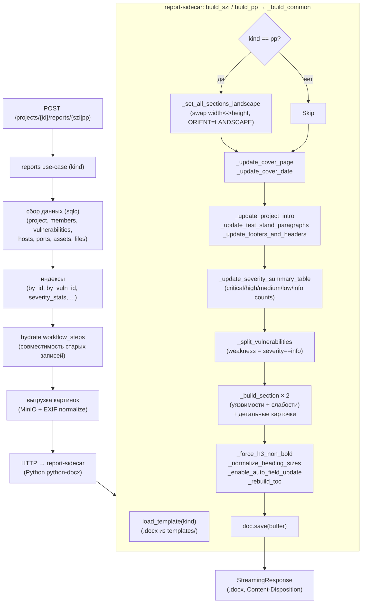

---

## 16. Импорт OpenAPI/Swagger по endpoint'ам

Импорт спецификации в каталог endpoint'ов хоста.

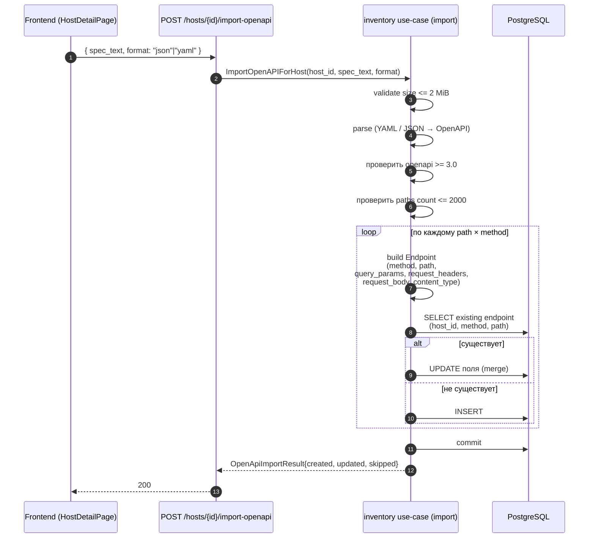

---

## 17. PCF JSON импорт — атомарный

Полный rollback при любой ошибке. Идемпотентность по идентифицирующим полям.

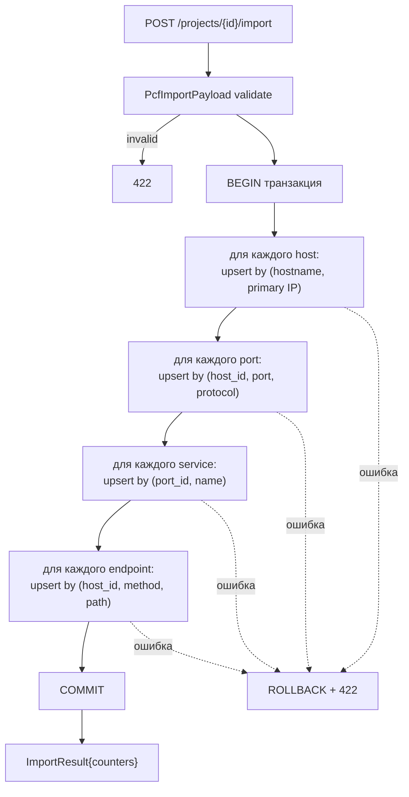

---

## 18. Frontend — высокоуровневая структура

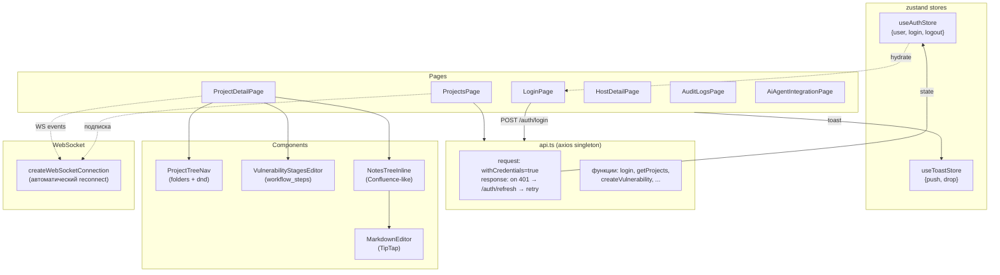

---

## 19. ER-диаграмма (укорочённая)

Полное описание — в [DB_SCHEMA.md](DB_SCHEMA.md). Здесь укрупнённая карта связей.

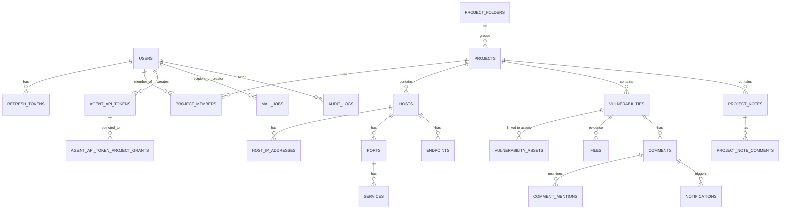
